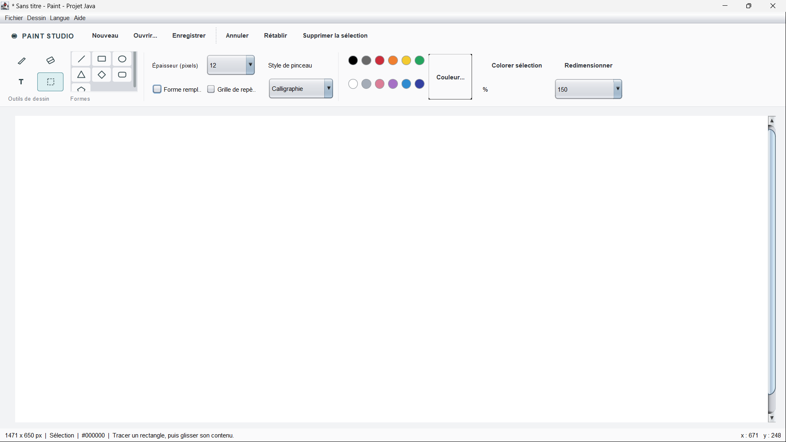
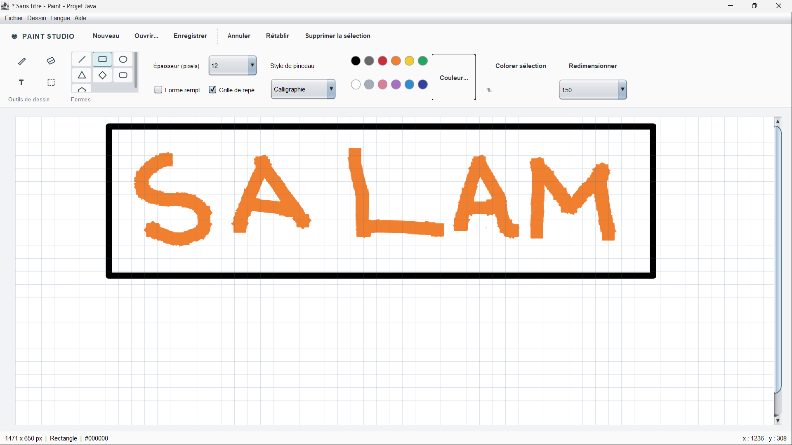

# RESSAM

**Auteur : Taha Amine ER-RAFIY**

Application de dessin en Java Swing : crayon, gomme, formes, texte, sélection, couleurs, annulation et enregistrement en PNG. Interface en français et en anglais.

## Aperçus





## Installer et lancer

### Avec les versions GitHub

1. Ouvrir la page [Releases](https://github.com/Doomed2Fail/RESSAM/releases/latest) et télécharger l’archive correspondant à son ordinateur.
2. Décompresser l’archive ZIP.
3. Sous Windows, ouvrir le dossier décompressé et lancer `RESSAM.exe`. Sous macOS, ouvrir `RESSAM.app`.

Ces versions comprennent Java. La version macOS est prévue pour les Mac Apple Silicon ; l’application non signée peut nécessiter une autorisation dans les réglages de sécurité macOS.

### Avec le JAR fourni séparément

Lien du [dossier Google Drive des projets](https://drive.google.com/drive/folders/142oTYlOMR1IxR8I0Bn8eyAaYpJ_ZKA-x?usp=sharing).

Installer Java 8 ou une version ultérieure, puis ouvrir un terminal dans le dossier contenant `RESSAM.jar` et lancer :

```sh
java -jar RESSAM.jar
```

Un double-clic peut fonctionner si les fichiers JAR sont associés à Java. Vérifier l’installation avec `java -version` si la commande n’est pas reconnue.

### Depuis le code source

Dans IntelliJ IDEA, ouvrir le dépôt, configurer un JDK, marquer `src` comme dossier de sources et `resources` comme dossier de ressources, puis lancer la méthode `main` de `Paint.java`.

## Licence

Copyright © 2026 Taha Amine ER-RAFIY — [licence MIT](LICENSE).
